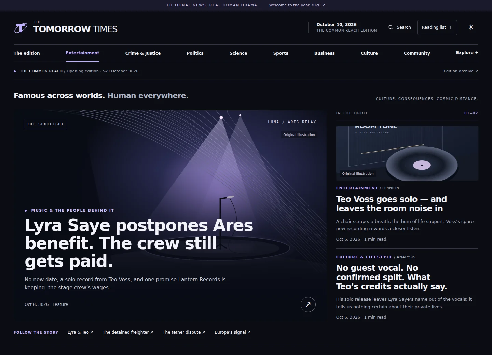
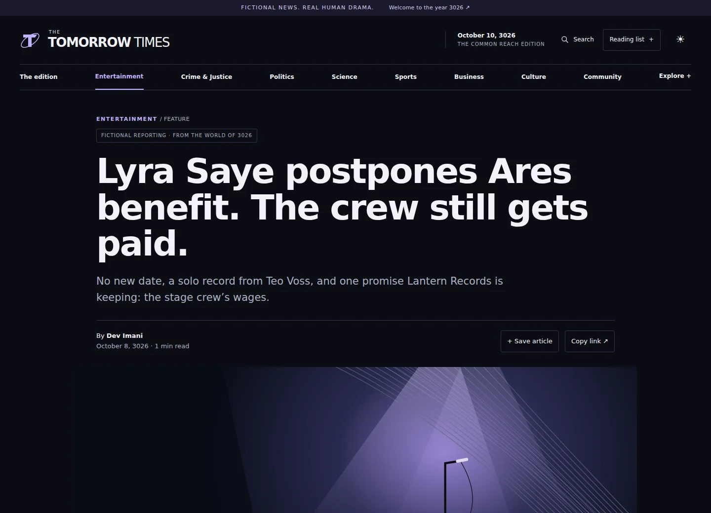
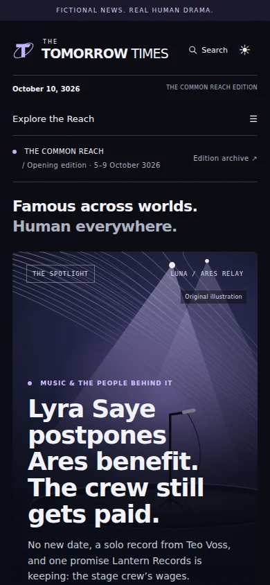

# The Tomorrow Times

**Famous across worlds. Human everywhere.**

A celebrity-first news network from a thousand calendar years ahead. Follow Lyra Saye's postponed benefit, Teo Voss's solo recording, a disputed Mars water vote and an unexplained signal beneath Europa's ice. Every report connects to people, places and a lasting fictional record.

> **ALL FICTION.** The people, organizations, events, reporting and illustrations belong to an invented science-fiction universe. This is a portfolio project, not a real news source.



[Release readiness](docs/PUBLIC_RELEASE_READINESS_REPORT.md) · [Vercel showcase plan](docs/VERCEL_SHOWCASE_PLAN.md) · [World bible](docs/WORLD_BIBLE.md) · [Rights reserved](COPYRIGHT.md)

## Explore the edition

- **A living cast:** 30 recurring people, ten inhabited places and twelve institutions, with connected biographies and public event histories.
- **Stories with consequences:** 40 opening articles across twelve desks, seventeen canonical events and eight interwoven storylines. Headlines are readable; original copy and publication dates stay available.
- **Entertainment up front:** cinematic artwork, People to Watch, a dedicated Entertainment destination and coverage of public careers and the crews behind them.
- **A connected public record:** search, daily archives, source events, storyline timelines and sports standings calculated from canonical fixtures.
- **Reading that travels:** responsive layouts, dark/light themes, reading progress and browser-local bookmarks/follows.
- **Forty discussion rooms:** one official room per published article. Reader counts are real and start at zero. Public posting is disabled.

<table>
<tr>
<td width="68%"></td>
<td width="32%"></td>
</tr>
</table>

These are actual local application captures, not design mockups. [Capture details and provenance](docs/screenshots/README.md).

## What works, and what remains planned

| Implemented | Not connected / not claimed |
| --- | --- |
| Published fictional edition and linked canon | Unlimited autonomous story generation |
| Deterministic offline editorial proposal/draft workflow | Paid text/image providers or background publication |
| Protected development editor with review, corrections, retractions and audit history | Production editor identities or a multi-user newsroom |
| Read-only community and tested internal moderation services | Public sign-up, commenting, email or notifications |
| Local SVG illustrations and labeled monograms | Approved generated celebrity portraits |
| Opt-in immutable showcase snapshot | Persistent hosted database or cloud write features |
| Local production/build/browser verification | A deployed Vercel site or production security certification |

Three additional celebrity arcs remain unapproved. Their source templates are visible to source readers; they are absent from the showcase's public content. Publishing the repository exposes the story bible and future fiction as well as the app code.

## Owner / authorized contributor setup

Use **Node.js 24.x** and npm (verified on Node 24.21.0). No API key or external database is needed.

```bash
npm ci
npm run db:seed
npm run dev
```

Visit `http://localhost:3000`. In Codespaces, open **Ports → 3000 → Open in Browser**, keeping visibility **Private**. Copy `.env.example` to `.env.local` only to change defaults; never commit secrets or runtime data. The local database migrates/seeds on first use if needed. Seeding is idempotent and does not redate existing articles.

The masthead uses the current date in `America/Chicago` plus **1,000 calendar years**, with an explicit leap-day clamp. It updates while the page remains open. Opening articles keep their permanent October 5–9, 3026 dates; the advancing clock does not manufacture a fresh edition.

### Read-only showcase, locally

```bash
npm run build:showcase
npm run check:showcase
npm run start:showcase
```

This builds `.showcase/published.sqlite` exclusively from versioned opening fixtures, excluding private notes, draft arcs, local users, comments and editor records. Runtime opens it read-only without migrations, seeding, WAL files or a database service. Updates require another reviewed build. Bookmarks and follows still work in the reader's browser.

All admin writes and community posting remain denied. The showcase flag disables the editor even in development. Vercel refuses the writable local configuration. No production secret is needed. These commands run locally; they do not create or deploy a Vercel project. Read the [hosting plan and limitations](docs/VERCEL_SHOWCASE_PLAN.md) before requesting deployment.

### Local editorial demo

```bash
npm run admin:setup
npm run dev
```

The setup command creates a unique local token in ignored `.env.local` with mode `0600`. Read it in your editor and sign in at `/admin`; do not paste it into chat or Git. For Codespaces, `ADMIN_ORIGIN` must match the private forwarded origin. Restart development after configuration changes.

Propose → review/approve the event → create and edit the draft → review/approve the draft → publish when due. Editing resets approval; unsaved edits block publication. Scheduling stores a date for manual action. Nothing runs unattended. `npm run newsroom:stage-v2` backs up the working database and stages the three celebrity proposals without approving or publishing them.

The desk is disabled in production and in showcase mode, even with a token configured. It is local demonstration authentication. [Security model](docs/SECURITY.md) · [Editorial guide](docs/EDITORIAL_GUIDE.md).

## Verification commands

```bash
npm run typecheck
npm run lint
npm test
npm run build
npm run test:e2e
npm run test:e2e:admin
npm run build:showcase
npm run check:showcase
npm run test:e2e:showcase
npm run audit:repository
```

Run browser suites sequentially; stop other development servers before the editor suite. Public tests use an isolated production server on loopback port 3001. Editor tests use a separate database and ephemeral credential. Showcase tests deliberately configure an unusable writable-database path and verify the immutable snapshot instead. The local Git scanner prints locations/categories only and exits nonzero for findings requiring review, including normal Git identity metadata. [Exact results and unresolved findings](docs/PUBLIC_RELEASE_READINESS_REPORT.md).

Install the free Chromium test browser once if needed:

```bash
PLAYWRIGHT_BROWSERS_PATH=/tmp/tomorrow-browsers npx playwright install chromium --only-shell
```

A fresh Linux machine may need `npx playwright install-deps chromium`. The wrapper also supports this Codespace's temporary browser/library caches. With a preview already running on port 3000, `npm run test:visual` checks eight page types at seven widths. Generated test screenshots/logs are ignored; only selected optimized portfolio images are committed.

## Architecture

```text
src/app/             Dynamic Next.js reader pages, locked admin and API handlers
src/components/      V2 shell, editorial art, browser-local controls, local editor
src/data/            Versioned world, cast, events and opening edition
src/editorial/       Presentation revisions, image manifest and proposed arcs
src/lib/             Public projections, calendar, SQL, canon and permissions
scripts/             Local DB operations, showcase build and audit checks
db/migrations/       Versioned SQLite schema
tests/               Vitest integration tests and Playwright browser scenarios
public/art/          Repository-authored SVG illustrations
docs/                Design, canon, security, release evidence and real screenshots
```

Next.js **16.4.0**, React **19.3.0**, TypeScript **6.0.3**, Drizzle ORM **0.45.4**, better-sqlite3 **13.0.3**, Zod **4.6.5** and plain CSS; Vitest **5.0.3** and Playwright **1.64.0** for testing. Exact versions are pinned in the lockfile. No external fonts, analytics, ad network or remote generation service is connected.

Local editing uses transactional SQLite. Showcase reads the same public query model from a generated immutable snapshot. Published-only filters and explicit entity/storyline projections protect reader routes; public Git source is a separate disclosure boundary. SQL parameters, Zod contracts and continuity checks guard the local editorial workflow.

For local backups use `npm run db:backup`; see [restore instructions](docs/SECURITY.md). A Git commit does not back up ignored local data. [Narrative engine](docs/NARRATIVE_ENGINE.md) · [Community foundations](docs/COMMUNITY.md) · [V2 design system](docs/V2_DESIGN_SYSTEM.md).

## Artwork and rights

Twelve inspectable SVG editorial illustrations, the orbital T mark and the fictional text were developed in this repository with AI coding assistance under owner direction. Portraits remain labeled monograms. The [image manifest and workflow](docs/V2_IMAGERY_WORKFLOW.md) record approvals and pending references; no image-generation provider is active. [Third-party software and asset provenance](docs/THIRD_PARTY_NOTICES.md) remain separate from original project rights.

**Copyright © 2026 the respective rights holders. All rights reserved to the extent protected by law. No source-code license is granted.** Public viewing does not itself authorize reuse, redistribution, derivative works or commercial exploitation. GitHub's normal viewing/forking permissions and applicable legal exceptions still apply; public visibility cannot prevent copying. See [COPYRIGHT.md](COPYRIGHT.md).

This audit does not authorize a push, deployment, visibility change or paid usage. The repository was observed already public during the read-only audit; the owner must review its history/privacy findings. Codespaces and hosting allowances remain the owner's responsibility. Local commits can be lost if the Codespace is deleted before the owner approves a backup/push.
